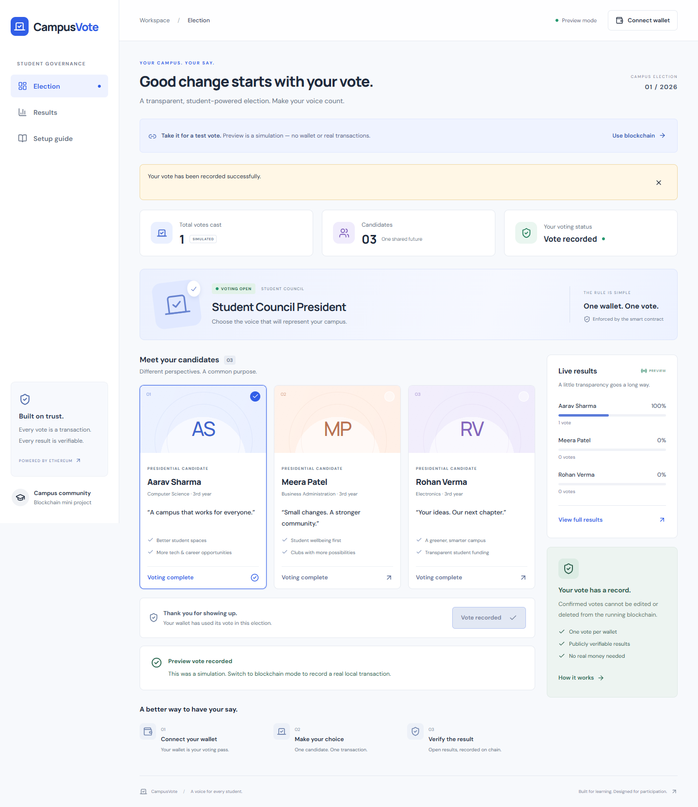
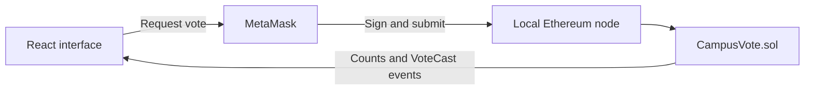

# CampusVote

**A simple Ethereum voting DApp for a student council election.**

A blockchain subject mini project built with **React, Solidity, ethers.js, and Ganache**. Connect a MetaMask wallet, choose a candidate, and record a vote on a local Ethereum blockchain. The responsive light interface shows live results and verifiable transaction receipts.

No real cryptocurrency, public testnet, database, paid API, or environment variables are required.



## Features

- **One vote per wallet**, enforced by the Solidity contract.
- **Three candidates** in a deliberately small student council election.
- **MetaMask integration** with automatic local-network setup.
- **Live results** refreshed from the contract every six seconds.
- **Verifiable activity** with transaction hashes, confirmation blocks, and vote events.
- **Owner controls** to close or reopen voting, without editing vote counts.
- **Wallet-free preview** with clearly labeled simulated votes.
- **Responsive light UI** with keyboard focus, reduced-motion support, and a built-in setup guide.

## Quick start

Requires **Node.js 22.12+** and npm.

```sh
git clone https://github.com/asadullah098/CampusVote.git
cd CampusVote
npm install
```

Try the interface without a wallet:

```sh
npm run dev
```

Open the URL printed by Vite, normally **http://127.0.0.1:5173**.

For blockchain voting, keep the frontend running and open two additional terminals in the project folder:

```sh
# Terminal 2: start the node and keep it running
npm run chain
```

```sh
# Terminal 3: deploy after the node starts
npm run deploy
```

Reload the app after deployment, then connect MetaMask.

## Wallet setup

1. Install [MetaMask](https://metamask.io/) in your browser and create a separate test wallet.
2. Import an account using an **Import key** printed by `npm run chain`. These accounts already contain local test ETH. Account **0** is the contract owner.
3. Click **Connect wallet** in CampusVote and approve the account and local-network requests.
4. Select a candidate, confirm your choice, and approve the transaction in MetaMask.

Manual network settings:

| Setting | Value |
| --- | --- |
| Network | CampusVote Local |
| RPC URL | `http://127.0.0.1:8545` |
| Chain ID | `31337` |
| Currency | `ETH` |

**Never use local test-account keys for real funds.** See the **[complete setup and wallet guide](docs/SETUP.md)** for account switching, resets, and troubleshooting.

## How it works



The contract checks that voting is open, the candidate ID is valid, and the sender has not already voted. It records the wallet in a mapping, increments the result counters, and emits a `VoteCast` event. The interface reads state and events using ethers.js.

| Function / state | Purpose |
| --- | --- |
| `vote(candidateId)` | Vote for candidate 0, 1, or 2. |
| `hasVoted(address)` | Check whether a wallet has voted. |
| `votes(candidateId)` / `totalVotes()` | Read result counters. |
| `setElectionOpen(bool)` | Owner-only close or reopen control. |
| `VoteCast` | Public voter and candidate event. |

## Tech stack

| Layer | Technology |
| --- | --- |
| Interface | React, Vite, CSS, Lucide icons |
| Wallet and contract access | MetaMask, ethers.js v6 |
| Smart contract | Solidity, compiled locally with solc |
| Local blockchain | Ganache with in-memory storage |
| Verification | Node.js test runner, Playwright |
| UI direction | ui-ux-pro-max; light minimalist dashboard |

## Commands and checks

| Command | Purpose |
| --- | --- |
| `npm run dev` | Start the frontend. |
| `npm run chain` | Start the local node and print funded test accounts. |
| `npm run deploy` | Compile, deploy, and generate the local contract configuration. |
| `npm test` | Test the contract on an isolated chain. |
| `npm run build` | Generate the frontend bundle in `dist/`. |
| `npm run preview` | Serve the built frontend locally. |

Contract tests cover invalid candidates, duplicate voting, counts, owner permissions, closed voting, reopening, and events. Browser checks cover preview voting, mobile layout, wallet feedback, and actual local-chain transactions through a test wallet provider. See [verification instructions](docs/SETUP.md#verification-and-production-build).

## Project structure

```text
CampusVote/
├── contracts/CampusVote.sol    # Voting rules and owner controls
├── scripts/
│   ├── chain.js               # Local Ethereum node
│   ├── compile.js             # Solidity compilation
│   └── deploy.js              # Deployment and configuration generation
├── src/
│   ├── main.jsx               # UI and wallet integration
│   └── styles.css             # Responsive light theme
├── public/                    # Generated deployment.json (gitignored)
├── tests/                     # Contract and browser checks
├── design-system/MASTER.md    # UI decisions
└── docs/SETUP.md               # Setup, wallet guide, troubleshooting
```

## Mini-project demonstration

1. Show the preview and explain simulated versus blockchain votes.
2. Start the node, deploy, and connect a funded test account.
3. Vote and show the receipt, updated results, and event.
4. Reload and reconnect to demonstrate duplicate-vote prevention.
5. Switch to another test account and cast another vote.
6. Connect the owner and demonstrate closing and reopening voting.

Concepts demonstrated: transaction signing, smart contract validation, mappings, on-chain state, events, access control, and transparent result verification.

## Limitations

- **Educational scope:** one wallet is not one verified student. Addresses and choices are public; there is no identity verification, secret ballot, or Sybil resistance.
- **Local session:** stopping the node removes its in-memory state. Restart, redeploy, import a fresh account, and reload. Preview votes reset on reload.
- **Generated configuration:** `public/deployment.json` is specific to a local deployment and is not committed. No private keys are committed.
- **Legacy development tooling:** Ganache's bundled dependencies have npm audit advisories, including high and critical findings. Automatic compatible fixes are limited by bundled dependencies and a Windows `fsevents` error. Keep the node on localhost. This project is not prepared for production elections or public node hosting.

## References

- [ethers.js v6](https://docs.ethers.org/v6/)
- [MetaMask custom networks](https://support.metamask.io/configure/networks/how-to-add-a-custom-network-rpc)
- [Solidity documentation](https://docs.soliditylang.org/)
